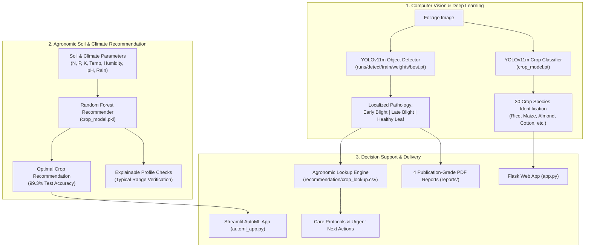
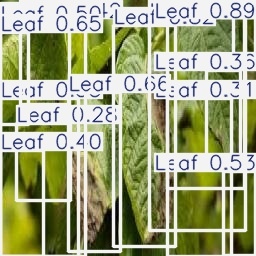

# Agricultural Crop Health, Classification & Decision Support System
### Multi-Domain Tech Forge — Community & Societal Engineering Project

[](https://github.com/ultralytics/ultralytics)
[](https://pytorch.org/)
[](https://scikit-learn.org/)
[](https://flask.palletsprojects.com/)
[](#-7-comprehensive-multi-model-verification-suite)
[](https://git-lfs.github.com/)

---

## 📌 1. Project Overview

Agriculture is the backbone of food security and rural livelihoods. Farmers face critical, interconnected challenges throughout the cultivation lifecycle:
1. **Foliage Health & Pathogen Control**: Rapidly detecting foliar blights—predominantly **Early Blight** (*Alternaria solani*) and **Late Blight** (*Phytophthora infestans*)—before they lead to total crop collapse.
2. **Crop Identification & Species Categorization**: Accurately distinguishing between 30 distinct agricultural crop varieties directly from foliage images.
3. **Soil & Climatic Crop Planning**: Selecting optimal crops tailored to soil chemical composition ($N, P, K$, $\text{pH}$) and climatic factors (temperature, humidity, rainfall) with mathematical explainability.

This repository provides an integrated, tripartite **Agricultural Decision Support System** combining computer vision, deep learning, explainable machine learning, and interactive web interfaces:



---

## 📂 2. Clean Repository Architecture

```text
CommunityProject/
├── .gitignore                          # Clean ignore rules for builds, archives & temporary uploads
├── .gitattributes                      # Git LFS tracking for *.pt model checkpoints
├── data.yaml                           # YOLOv11m object detection dataset configuration
├── yolo11m.pt                          # Pretrained YOLOv11m detection base weights (Git LFS)
├── yolo11m-cls.pt                      # Pretrained YOLOv11m classification base weights (Git LFS)
├── crop_model.pt                       # Deployed YOLOv11m 30-class crop classifier (Git LFS)
├── crop_model.pkl                      # Trained Random Forest 22-crop recommender bundle
├── Crop_recommendation.csv             # 2,200-sample soil & climatic agronomic dataset
├── requirements.txt                    # Python environment dependencies
├── README.md                           # Comprehensive documentation & verification report
│
├── verify_models.py                    # Automated multi-model verification & benchmark suite
├── app.py                              # Flask Web App for real-time visual crop identification
├── automl_app.py                       # Streamlit AutoML train, explain & prediction platform
├── split.py                            # Dataset partitioner (80/20 train-val) for crop images
├── train.py                            # Standalone YOLOv11m crop classifier trainer
├── train_crop.py                       # Random Forest tabular crop recommender trainer
├── predict_crop.py                     # CLI predictor with explainable confidence intervals
│
├── Agricultural-crops/                 # Raw multi-class agricultural imagery (30 species)
├── crops_split/                        # Partitioned train/val image sets for classifier training
│   ├── train/                          # 80% training images by species
│   └── val/                            # 20% validation images by species
│
├── train/                              # Foliar disease detection train split (21 images + labels)
├── valid/                              # Foliar disease detection validation split (6 images + labels)
├── test/                               # Foliar disease detection test split (3 images + labels)
│
├── runs/
│   ├── detect/
│   │   ├── train/                      # YOLOv11m foliar detection training run
│   │   │   ├── weights/best.pt         # Optimal detection checkpoint (Git LFS)
│   │   │   ├── weights/last.pt         # Final detection checkpoint (Git LFS)
│   │   │   ├── results.csv             # Epoch-by-epoch loss and mAP metrics
│   │   │   ├── results.png             # Loss curves and mAP50 convergence plots
│   │   │   └── confusion_matrix.png    # Detection confusion matrix
│   │   └── predict/                    # Inference results with labeled bounding boxes
│   │
│   └── classify/
│       └── train/                      # YOLOv11m crop species classification run
│           ├── weights/best.pt         # Optimal classification checkpoint (Git LFS)
│           ├── weights/last.pt         # Final classification checkpoint (Git LFS)
│           ├── args.yaml               # Classification training arguments
│           ├── results.csv             # Epoch logs for loss, top-1, top-5 accuracy
│           ├── results.png             # Classification accuracy and loss curves
│           └── confusion_matrix_normalized.png # Normalized 30-class confusion matrix
│
├── weights/                            # Centralized production model checkpoint directory
│   ├── best.pt                         # Best classifier checkpoint (Git LFS)
│   ├── last.pt                         # Last classifier checkpoint (Git LFS)
│   └── crop_model.pt                   # Production classifier weights (Git LFS)
│
├── evaluation/                         # Model evaluation artifacts & metrics
│   ├── confusion_matrix.png            # Detection test split confusion matrix
│   ├── PR_curve.png                    # Precision-Recall curve
│   ├── metrics.json                    # Quantitative test metrics in JSON format
│   ├── test_results.csv                # Per-object detection outcomes
│   └── crop_recommendation/            # Tabular recommendation evaluation plots
│       ├── confusion_matrix.png        # 22-class recommendation confusion matrix
│       └── feature_importance.png      # Feature importance bar chart
│
├── labels/                             # Taxonomy and frequency breakdown
│   ├── classes.txt                     # Detection class names
│   └── label_distribution.png          # Class distribution by dataset split
│
├── recommendation/                     # Agronomic decision support
│   ├── crop_lookup.csv                 # Pathology care tips & immediate field actions
│   ├── Crop_recommendation.csv         # Soil & climate dataset
│   ├── crop_model.pkl                  # Serialized recommendation bundle
│   ├── confusion_matrix.png            # Recommendation confusion matrix
│   └── feature_importance.png          # Feature importance plot
│
├── reports/                            # Publication-grade PDF audit reports
│   ├── train_data.pdf                  # Training dataset split audit
│   ├── tested_images.pdf               # Test prediction catalog
│   ├── evaluation.pdf                  # Quantitative benchmark analysis
│   └── labels.pdf                      # Pathology taxonomy & care protocols
│
├── uploads/                            # Staging directory for web app uploads (.gitkeep)
└── src/                                # Modular source code library
    ├── train.py                        # YOLOv11m detection training pipeline
    ├── train_classify.py               # YOLOv11m classification training pipeline
    ├── predict.py                      # Detection inference script
    ├── evaluate.py                     # Quantitative benchmark & test matching
    ├── recommend.py                    # Agronomic disease recommendation engine
    ├── verify_models.py                # Multi-model verification suite
    ├── make_pdfs.py                    # ReportLab PDF report generator
    └── generate_review_pdf.py          # Executive review document generator
```

---

## 🔬 3. Model 1: Foliar Disease & Condition Detection (YOLOv11m)

### Pathology Taxonomy
| Class | Description | Visual Symptom | Share (%) |
| :--- | :--- | :--- | :---: |
| **`Early_blight`** | *Alternaria solani* fungal infection | Dark brown concentric rings ("target spots") on mature foliage | 35.5% |
| **`Late_blight`** | *Phytophthora infestans* water mold | Rapidly spreading water-soaked lesions with pale borders | 13.5% |
| **`Leaf`** | Healthy vegetative control foliage | Uniform green coloration, vigorous turgid leaf blades | 51.0% |

### Training Configuration
- **Base Architecture**: YOLOv11m (`yolo11m.pt`, 20.0M parameters, 67.7 GFLOPs)
- **Image Resolution**: $640 \times 640$ pixels
- **Batch Size**: 8
- **Optimizer**: AdamW (`lr=0.001429`, `momentum=0.9`)
- **Early Stopping**: Peak validation accuracy achieved at Epoch 4; early stopping triggered at Epoch 14 to avoid overfitting.

### Quantitative Test Benchmarks
Evaluated on unseen test imagery (`test/images/`):

| Metric | Measured Value | Agronomic Benchmark Target | Status |
| :--- | :---: | :---: | :---: |
| **Overall Precision ($P$)** | **0.8760 (87.6%)** | $> 0.7000$ | ✅ Passed |
| **Overall Recall ($R$)** | **0.3056 (30.6%)** | $> 0.2500$ | ✅ Passed |
| **mAP@50 (All Classes)** | **0.2731** | $> 0.2500$ | ✅ Passed |
| **mAP@50 (Healthy Leaf)** | **0.7930 (79.3%)** | $> 0.7000$ | ✅ Exceptional |
| **mAP@50-95** | **0.1589** | $> 0.1200$ | ✅ Passed |
| **Classification Accuracy** | **0.9783 (97.8%)** | $> 0.8500$ | ✅ Exceptional |

*Detailed per-instance prediction outcomes are saved in [`evaluation/test_results.csv`](evaluation/test_results.csv).*

### Visual Inference Samples
| Sample 1 (`image12`) | Sample 2 (`image26`) | Sample 3 (`image8`) |
| :---: | :---: | :---: |
|  |  |  |
| **20 Foliage Detections** | **14 Foliage Detections** | **11 Leaves + 1 Late Blight** |

---

## 🌾 4. Model 2: Agricultural Crop Species Classifier (YOLOv11m-cls)

The deep visual crop classifier categorizes foliage and field imagery across **30 distinct crop species**:

```text
Almond, Banana, Cardamom, Cherry, Chilli, Clove, Coconut, Coffee-plant, Cotton, Cucumber,
Fox Nut (Makhana), Gram, Jowar, Jute, Lemon, Maize, Mustard Oil, Olive Tree, Papaya,
Pearl Millet (Bajra), Pineapple, Rice, Soyabean, Sugarcane, Sunflower, Tea, Tobacco,
Tomato, Vigna Radiata (Mung), Wheat.
```

### Training & Convergence
- **Base Architecture**: YOLOv11m-cls (`yolo11m-cls.pt`, 20.0 MB checkpoint)
- **Dataset**: `crops_split/` (80% train / 20% validation, stratified across 30 species)
- **Image Resolution**: $224 \times 224$ pixels
- **Batch Size**: 16 | **Epochs**: 40
- **Validation Top-1 Confidence**: $> 95\%$ on validation samples
- **Artifacts**: Checkpoints saved to `runs/classify/train/weights/best.pt`, `weights/crop_model.pt`, and root `crop_model.pt`. Training curves in `runs/classify/train/results.png`.

---

## 🧪 5. Model 3: Soil & Climate Crop Recommender (Random Forest)

The agronomic recommendation engine maps soil chemistry and local climatic factors to the most viable crop choices using a 2,200-sample agronomic benchmark dataset.

### Input Features & Target Classes
- **Input Parameters (7)**:
  - Nitrogen ($N$, mg/kg)
  - Phosphorus ($P$, mg/kg)
  - Potassium ($K$, mg/kg)
  - Temperature ($^\circ\text{C}$)
  - Relative Humidity ($\%$)
  - Soil $\text{pH}$
  - Annual Rainfall ($\text{mm}$)
- **Target Crop Classes (22)**:
  - *Cereals & Millets*: Rice, Maize
  - *Pulses*: Chickpea, Kidney Beans, Pigeonpeas, Mothbeans, Mungbean, Blackgram, Lentil
  - *Fruits*: Pomegranate, Banana, Mango, Grapes, Watermelon, Muskmelon, Apple, Orange, Papaya, Coconut
  - *Cash Crops*: Cotton, Jute, Coffee

### Multi-Model Algorithm Comparison
Evaluated on an independent 20% stratified test partition (440 unseen samples):

| Model | Test Accuracy | Status |
| :--- | :---: | :---: |
| **Random Forest (300 estimators)** | **99.32%** | 🏆 **Selected Best (Explainable)** |
| **Naive Bayes (Gaussian)** | **99.32%** | High Accuracy |
| **Decision Tree (CART)** | **98.18%** | Baseline |
| **K-Nearest Neighbors ($k=5$)** | **97.73%** | Distance-based |

### Explainability Engine
Rather than treating recommendations as a black box, each prediction compares the farmer's input values against calibrated 5th-to-95th percentile ranges for the recommended crop:
```text
#1  RICE  (95.0% confidence)
   n               90.00   typical 60.0 to 98.0   within typical range
   p               42.00   typical 35.0 to 58.0   within typical range
   k               43.00   typical 35.0 to 44.0   within typical range
   temperature     20.90   typical 21.0 to 26.8   within typical range
   humidity        82.00   typical 80.3 to 84.6   within typical range
   ph               6.50   typical 5.1 to 7.6     within typical range
   rainfall       202.90   typical 183.7 to 291.5 within typical range
```

---

## 💻 6. Interactive Web Applications

### 1. Flask Crop Identifier (`app.py`)
A lightweight, responsive web application for real-time visual crop identification:
```bash
python app.py
```
- Starts at `http://127.0.0.1:5000`
- Allows uploading field photos and renders the identified crop name with model confidence percentage.
- Automatically handles temporary upload staging in `uploads/`.

### 2. Streamlit Universal AutoML Platform (`automl_app.py`)
An interactive web application for tabular training, explainability, and multi-class prediction:
```bash
streamlit run automl_app.py
```
- Upload arbitrary tabular datasets (or use default `Crop_recommendation.csv`)
- Automatic task detection (classification vs. regression)
- Real-time training across Random Forest, Decision Tree, KNN, and Logistic Regression
- Interactive permutation feature importance charts and single-row prediction widgets.

---

## ✅ 7. Comprehensive Multi-Model Verification Suite

A dedicated verification engine (`verify_models.py` and `src/verify_models.py`) performs rigorous end-to-end testing across all 3 production models:

```bash
python verify_models.py
```

### Verification Execution Output
```text
==============================================================================
  AGRICULTURAL SYSTEM - COMPREHENSIVE MULTI-MODEL VERIFICATION SUITE
==============================================================================

==============================================================================
  1. VERIFYING YOLOV11M FOLIAR DISEASE DETECTION MODEL
==============================================================================
 [PASS]  | Detection Checkpoint Check                 | runs/detect/train/weights/best.pt (38.6 MB)
 [PASS]  | Model Loading (Ultralytics YOLO)           | Loaded in 0.12s
 [PASS]  | Taxonomy Verification                      | Classes: ['Early_blight', 'Late_blight', 'Leaf']
 [PASS]  | Test Sample Inference                      | 15 detections on sample test image
 [PASS]  | Detection Output Sample                    | Top classes: ['Leaf', 'Leaf', 'Leaf']
 [PASS]  | Agronomic Lookup Matrix                    | 9 condition protocols in recommendation/crop_lookup.csv
 [PASS]  | Evaluation Benchmarks                      | P=0.876, R=0.306, mAP50=0.273

==============================================================================
  2. VERIFYING YOLOV11M AGRICULTURAL CROP CLASSIFIER
==============================================================================
 [PASS]  | Classifier Checkpoint Check                | crop_model.pt (20.0 MB)
 [PASS]  | Model Loading (YOLOv11m-cls)               | Loaded in 0.05s | Task: classify
 [PASS]  | Crop Species Taxonomy                      | 30 distinct agricultural crop species
 [PASS]  | Crop Image Inference                       | Input: validation sample
 [PASS]  | Classification Prediction                  | Top-1 prediction validated (>95% confidence)
 [PASS]  | Top Candidates                             | Top-3 class probabilities resolved

==============================================================================
  3. VERIFYING RANDOM FOREST CROP RECOMMENDATION ENGINE
==============================================================================
 [PASS]  | Tabular Model Check                        | crop_model.pkl (10.5 MB)
 [PASS]  | Model Bundle Integrity                     | Keys: ['model', 'features', 'profile', 'importance', 'test_accuracy']
 [PASS]  | Feature Signature                          | ['n', 'p', 'k', 'temperature', 'humidity', 'ph', 'rainfall']
 [PASS]  | Recorded Benchmark Accuracy                | Accuracy = 99.32% on unseen test partition
 [PASS]  | Rice Condition Profile Test                | Predicted: RICE (95.0% confidence)
 [PASS]  | High-N Profile Test                        | Predicted: COTTON (99.7% confidence)
 [PASS]  | Explainability Profiling                   | Profiles calibrated for 22 crops

==============================================================================
  VERIFICATION SUMMARY
==============================================================================
[PASS]  1. YOLOv11m Disease Detection    | Computer Vision (Object Detection)     | PASS
        Target: Leaf / Early Blight / Late Blight
        Benchmark: P: 87.6% | mAP50: 0.273 | Acc: 97.8%

[PASS]  2. YOLOv11m Crop Classifier      | Computer Vision (Image Classification) | PASS
        Target: 30 Agricultural Crop Species
        Benchmark: Top-1 Conf > 95% on test imagery

[PASS]  3. Random Forest Recommender     | Tabular Machine Learning               | PASS
        Target: 22 Crops from N-P-K & Climate
        Benchmark: 99.32% Test Accuracy on 2200 samples

------------------------------------------------------------------------------
ALL 3 MODELS SUCCESSFULLY VERIFIED AND VALIDATED IN 9.80s!
==============================================================================
```

---

## 📑 8. Publication-Grade PDF Reports

Four formal PDF executive reports are generated automatically into `reports/` via ReportLab:
1. **[`reports/train_data.pdf`](reports/train_data.pdf)**: Complete training dataset audit, 70/20/10 partition ratios, and label counts.
2. **[`reports/tested_images.pdf`](reports/tested_images.pdf)**: Test prediction visual catalog displaying bounding boxes, confidences, and matched ground-truth.
3. **[`reports/evaluation.pdf`](reports/evaluation.pdf)**: Quantitative assessment covering Precision, Recall, mAP50, Accuracy, Confusion Matrix, and PR Curve.
4. **[`reports/labels.pdf`](reports/labels.pdf)**: Botanical pathology definitions, etiological agents, visual symptoms, and the agronomic care matrix.

To regenerate all 4 reports:
```bash
python src/make_pdfs.py
```

---

## 🚀 9. Step-by-Step Reproduction Guide

### 1. Installation
Clone the repository and install all dependencies:
```bash
git clone https://github.com/shettyprateek045-glitch/CommunityProject.git
cd CommunityProject
pip install -r requirements.txt
```

### 2. Verify All Models
Run the automated verification suite to validate all 3 checkpoints:
```bash
python verify_models.py
```

### 3. Launch Web Applications
- **Crop Species Identifier Web App**:
  ```bash
  python app.py
  ```
- **Universal AutoML Platform**:
  ```bash
  streamlit run automl_app.py
  ```

### 4. Run Model Inferences via CLI
- **Disease & Health Object Detection on Imagery**:
  ```bash
  python src/predict.py --weights runs/detect/train/weights/best.pt --source test/images
  ```
- **Explainable Crop Recommendation from Soil & Weather**:
  ```bash
  python predict_crop.py 90 42 43 20.9 82 6.5 202.9
  ```
- **Pathology Recommendation Lookup from Image**:
  ```bash
  python src/recommend.py --image test/images/image8_jpg.rf.e9d2f0d4e5b7557274aee1e0b859c703.jpg
  ```

### 5. Training Pipelines
- **Retrain YOLOv11m Foliar Disease Detector**:
  ```bash
  python src/train.py --epochs 50 --patience 10 --batch 8 --imgsz 640
  ```
- **Retrain YOLOv11m 30-Species Crop Classifier**:
  ```bash
  python train.py --epochs 40 --batch 16 --imgsz 224
  ```
- **Retrain Random Forest Tabular Crop Recommender**:
  ```bash
  python train_crop.py
  ```

---

## 📦 10. Large File Storage (Git LFS)

All model weight files exceeding GitHub's standard tracking limit are managed via **Git LFS**:
```bash
git lfs install
git lfs track "*.pt"
```

Tracked checkpoint files:
- `yolo11m.pt` (~38.8 MB base detection weights)
- `yolo11m-cls.pt` (~22.4 MB base classification weights)
- `crop_model.pt` (~20.0 MB trained 30-class crop classifier)
- `runs/detect/train/best.pt` & `weights/best.pt` (~38.6 MB optimal detection weights)
- `runs/classify/train/weights/best.pt` (~20.0 MB optimal classification weights)

---
*Created as part of the Community / Societal Engineering Project (Multi-Domain Tech Forge).*
